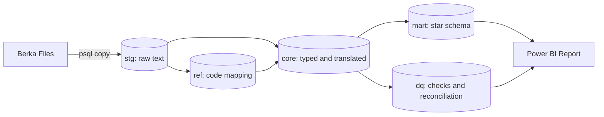
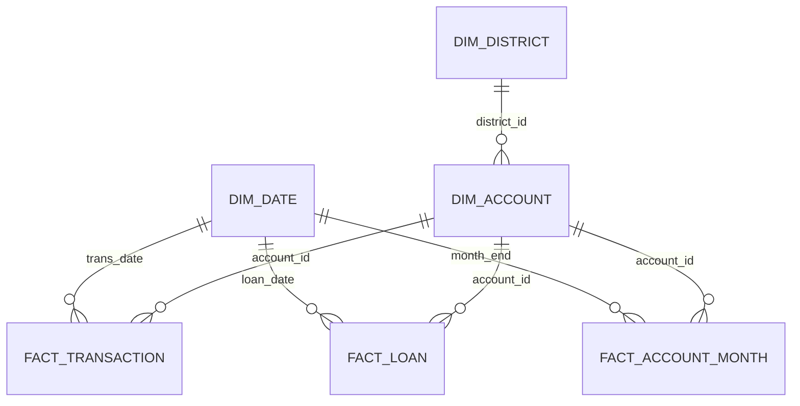

# Retail Banking MI Pack & Loan Portfolio Risk Review
**A governed, reconciled management information pack and Power BI analytics platform built on 1.05M transactions, identifying loan default drivers and credit card cross-sell opportunities for retail banking executives.**

[BRD (v0.9)](docs/BRD.md) · [EDA Notes](docs/eda_notes.md) · [Defect Log](docs/defect_log.md) · [Decision Log](docs/decision_log.md)

**Status:** In Progress (Week 1 completed: Staging, Reference, Core schemas, BRD, and EDA)

---

## The Problem
Retail Banking leadership previously operated on manually assembled monthly Excel packs prone to reconciliation discrepancies between Finance and Retail. Figures frequently broke down during executive reviews, delaying strategic actions. Furthermore, Credit Risk lacked early-warning signals to identify pre-default behaviour, and branches lacked a governed targeting list for card cross-selling.

## What I Delivered
- **Reproducible Data Pipeline:** Automated PostgreSQL architecture (`stg` raw staging, `ref` translation mappings, and typed `core` entities) covering 8 tables and 1,056,320 transactions.
- **Data Governance & Auditability:** Formal Defect Log (`DEF-001`), Decision Log (`DEC-001`), and comprehensive Business Requirements Document ([BRD v0.9](docs/BRD.md)) tracing 10 functional requirements (FR-01 to FR-10).
- **Exploratory Data Analysis (EDA):** Complete baseline SQL suite (`sql/eda_week1.sql`) and executive briefing notes (`docs/eda_notes.md`) establishing transaction velocity, regional liquidity, and credit risk baselines.

## Key Findings
1. **Transaction Turnover Growth (11.4x):** Annual volume grew from 28.2k transactions (204.3M CZK) in 1993 to 322.3k transactions (1.89B CZK) in 1998 across 4,500 accounts.
2. **Batch Processing Discovery (17.34%):** Exactly 183,114 transactions carry no operation code; our audit proved 100% of these represent automated interest credit entries (`UROK`), establishing an operational baseline for upcoming Data Quality rules.
3. **Credit Risk Baseline (11.14% Default Rate):** 76 of 682 loans are in default (31 finished unpaid contracts [Status B] and 45 active in-debt contracts [Status D]), representing 15.58M CZK in exposure. Finished loans exhibit a 13.25% default rate.
4. **Card Cross-Sell Opportunity (80.2% Uncarded):** Only 892 cards exist across 4,500 accounts (~20% penetration), concentrated in classic tiers (659). Prague leads regional account liquidity with an average final balance of 44,939.82 CZK.

## Architecture

## Data Model

